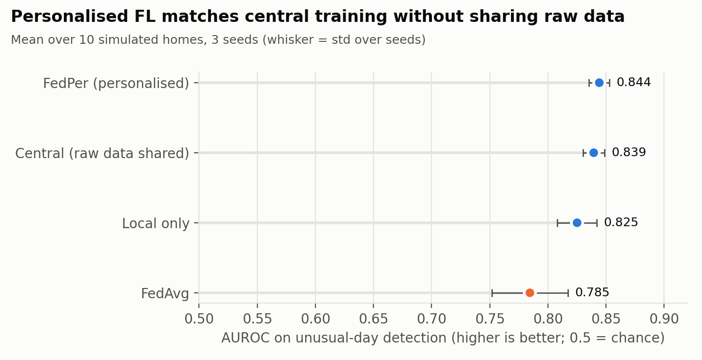
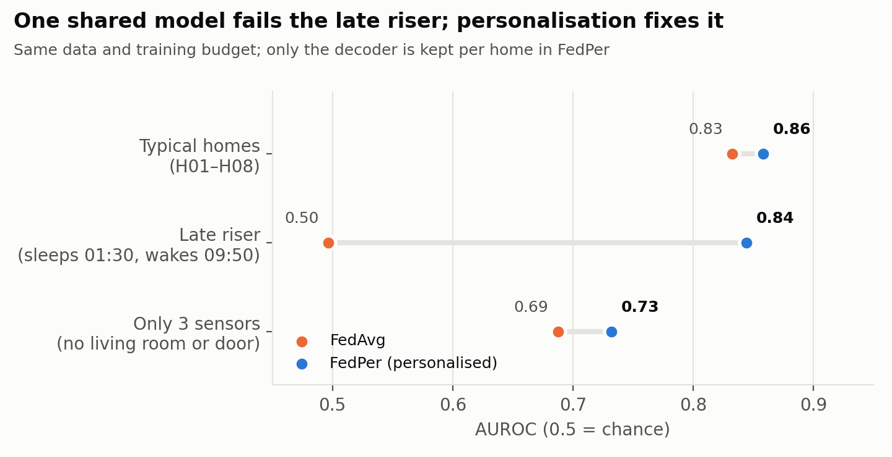
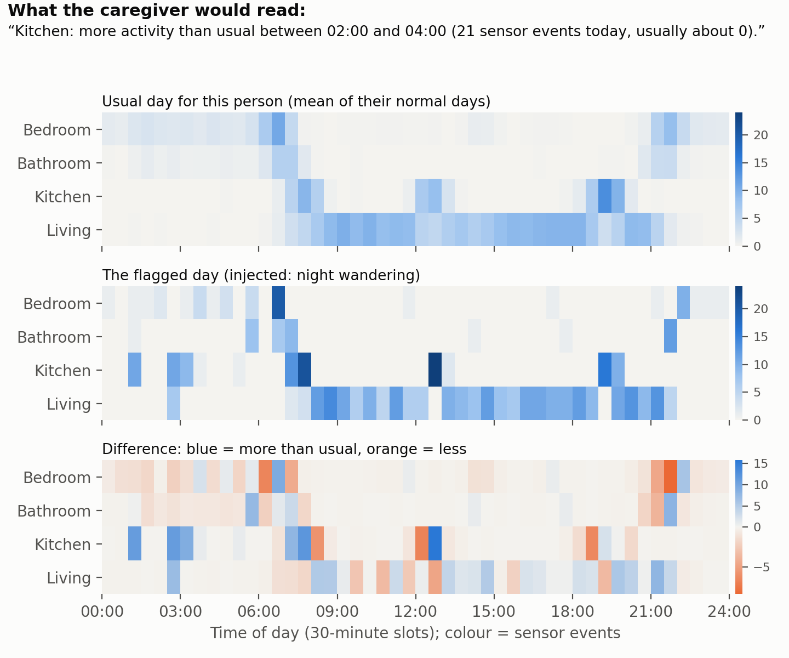
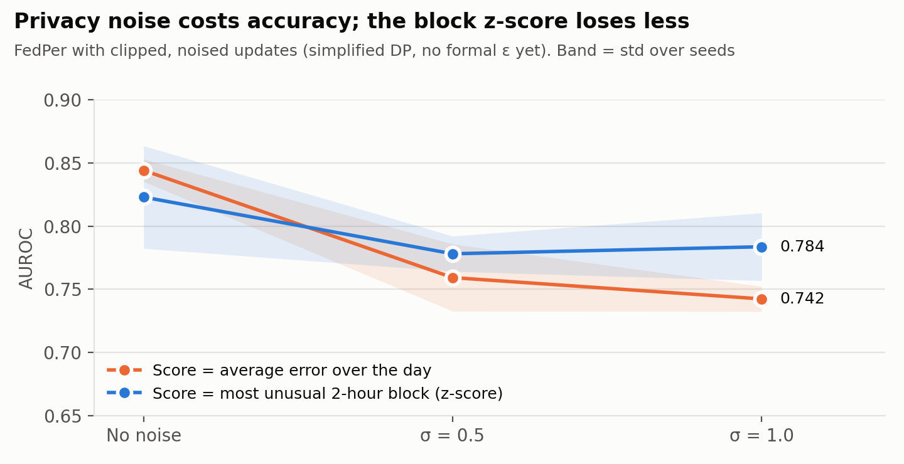

# FedRoutine: Personalised Federated Anomaly Detection for Older Adults Living Alone

A working research prototype. It learns each person's normal day from simple
home sensors, flags days that are unusual for **that** person, and explains each
alert in one plain sentence. Raw sensor data never leaves the home.

> **Status (version 0.1, October 2026):** full pipeline runs end to end on
> simulated smart homes, with results over 3 random seeds. A reader for real
> CASAS data is written and tested on files in CASAS format. Running on real
> CASAS homes is the next step (see "Next steps").

---

## Research question

Can a personalised federated model learn each older person's normal daily
routine from ambient sensors, detect meaningful changes in it, and explain those
changes in plain language to a caregiver, without raw data leaving the home,
even when homes differ in layout, sensors and routine?

## What is in this repository

```
src/
  simulate.py       smart-home simulator: different homes, routines, sensor layouts,
                    and 5 kinds of injected unusual days
  features.py       sensor events -> day matrix (5 room types x 48 half-hour slots) + room mask
  model.py          routine autoencoder (shared encoder, personal decoder)
  federated.py      local / central / FedAvg / FedPer training, optional DP noise
  explain.py        alert explanation, hit-rate check, deletion (faithfulness) test
  casas_loader.py   reader for real CASAS files, with automatic room mapping
run_experiment.py   main experiment on simulated homes -> results/
make_figures.py     figures -> results/figures/
run_casas.py        same method on real CASAS homes
tests/              tests for the loader, features and loss (python tests/test_pipeline.py)
```

## Quick start

```bash
pip install -r requirements.txt
python tests/test_pipeline.py        # 4 tests, a few seconds
python run_experiment.py --quick     # about 20 seconds, checks everything works
python run_experiment.py             # full run, 3 seeds, about 5 minutes on a laptop CPU
python make_figures.py
```

## How it works

```
sensor events in each home
      │
      ▼
day matrix: 5 room types x 48 half-hour slots (missing rooms masked)
      │
      ▼
autoencoder rebuilds "a normal day for this person"
   encoder  ── shared across homes with federated learning (only weights are sent)
   decoder  ── stays in the home, learns that home's habits and layout
      │
      ▼
anomaly score = how badly today is rebuilt  ──►  alert if above this home's own threshold
      │
      ▼
explanation: the room x 2-hour block that differs most, described against the
person's own usual days
```

**Simulated homes.** Each run creates 10 homes. Each home has its own wake and sleep
times, meal times, outings, naps and night toilet trips, plus a different number of
sensors per room. Two homes are deliberately hard: a **late riser** (sleeps 01:30,
wakes about 09:50) and a home with **only 3 sensors** (no living-room or door sensor).
Per home: 70 normal training days, 14 normal validation days (used to set the alert
threshold at the 97th percentile), and 40 test days including 10 unusual days
(2 each of: skipped meal, long inactivity, night wandering, disturbed sleep, late wake).
Unusual days are created by changing the person's timeline, not by editing numbers.

## Results (version 0.1, simulated data)

All numbers: mean over the 10 homes, then mean ± std over 3 seeds.
Full tables are in `results/`.

| Method | Raw data leaves home? | AUROC | F1 | False alarms / week | Sent per home per round |
|---|---|---|---|---|---|
| Local only | No | 0.825 ± 0.017 | 0.51 | 0.72 | nothing |
| Central | **Yes** | 0.839 ± 0.009 | 0.58 | 0.71 | all raw data |
| FedAvg | No | 0.785 ± 0.033 | 0.52 | 0.79 | 70,160 weights (548 KB) |
| **FedPer (personalised)** | No | **0.844 ± 0.009** | 0.52 | **0.54** | 34,976 weights (273 KB) |

(Scores use the average error over the day. F1 and false alarms are at each home's
own threshold.)



**Main findings**

1. **Personalised FL matched central training (0.844 vs 0.839 AUROC) without sharing
   raw data**, and it had the fewest false alarms (0.54 per week).
2. **Standard FedAvg failed completely on the late riser: AUROC 0.50, which is chance
   level.** One shared model learns an "average" routine that does not fit this person.
   Keeping the decoder in each home (FedPer) brought it back to 0.84.
3. FedPer sends **half as much data per round** as FedAvg, because only the encoder is shared.
4. The 3-sensor home is the hardest for every method (0.69 to 0.78). Missing sensors
   make "nothing happening" hard to interpret.



**Explanations** (FedPer, 153 detected unusual days):

- The top explanation pointed to the correct room and time in **71%** of alerts
  (night wandering 95%, long inactivity 94%, disturbed sleep 78%, skipped meal 78%,
  late wake 40%).
- **Faithfulness (deletion test):** replacing the highlighted block with the expected
  values lowered the anomaly score by **21.6%** on average; replacing a random block of
  the same size lowered it by only 1.8%. The explanation points at what actually drove
  the score.

Example (night wandering, injected):
> "Kitchen: more activity than usual between 02:00 and 04:00 (21 sensor events today,
> usually about 0)."



**Privacy noise.** Clipping each home's update and adding Gaussian noise (σ = 1.0)
lowered FedPer's AUROC from 0.844 to 0.742 with the day-average score, but only from
0.823 to 0.784 with the block z-score (below). This is a simplified version of DP-FedAvg;
a formal privacy budget (ε) is not computed yet.



## What did not work, and what is still open

- **Scoring by the single worst block made things worse.** In version 1 the score was
  the average error over the whole day, which can dilute a short event like a skipped
  breakfast. Scoring by the most unusual 2-hour block instead picked up random noise:
  FedAvg's F1 stayed at 0.52 and false alarms went up.
- **Fix that partly worked:** compare each block with how much that block normally
  varies for this person (z-score). F1 improved for every method (FedPer 0.52 → 0.58,
  FedAvg 0.52 → 0.59), but AUROC became less stable (FedPer 0.823 ± 0.041). Which
  score to use is still an open question.
- **"Nothing happening" is the hardest case.** Even the best setting detects only about
  15–30% of skipped meals, long inactivity and disturbed sleep at the alert threshold,
  while late wake and night wandering are detected 95–100% of the time. An afternoon
  with no movement looks the same as an afternoon out of the house, especially in
  homes with no door sensor. This is a real research problem and a main target for
  the master's work.

## Limitations

- **Simulated data.** The simulator encodes my own assumptions about routines.
  Results on real homes will be lower and must be reported separately.
- Homes H01–H08 are newly generated in each seed; only the two special homes
  (late riser, 3 sensors) are the same type in every seed.
- The model is a small fully connected autoencoder. Time structure (for example
  a 1D convolution or Transformer over the day) is not used yet.
- Counts are scaled with one fixed constant for all homes. Per-home normalisation
  is an obvious baseline still to add.
- The DP step has no formal ε accounting.
- Federated learning is simulated in one process. Flower can replace the training
  loop without changing the model or evaluation.

## Next steps

1. Download CASAS datasets (Aruba, Milan and other single-resident homes) and run
   `run_casas.py`; check flagged days by hand against the activity labels.
2. Inject the same five kinds of unusual days into held-out real CASAS days to get
   AUROC on real routines.
3. Add per-home normalisation and a temporal model; compare with FedProx and Ditto.
4. Move training to Flower; add formal DP accounting (Opacus).
5. Ask care staff or nursing students to rate the explanations.

## Running on real CASAS data

```bash
# each file is one home; rooms are inferred from the activity labels
python run_casas.py data/aruba/data data/milan/data

# or give your own sensor -> room map made from the floor plan
python run_casas.py data/aruba/data --room-map maps/aruba.json
```

A room map is a JSON file such as `{"M003": "bedroom", "M015": "kitchen", "D001": "entrance"}`.
Always check automatically inferred rooms against the floor plan.

## References

- Arivazhagan, M. G. et al. (2019). Federated learning with personalization layers. arXiv:1912.00818.
- Cook, D. J. et al. (2013). CASAS: A smart home in a box. *IEEE Computer*, 46(7).
- McMahan, B. et al. (2017). Communication-efficient learning of deep networks from decentralized data. *AISTATS*.
- McMahan, B. et al. (2018). Learning differentially private recurrent language models. *ICLR*.
- Zhu, L., Liu, Z. and Han, S. (2019). Deep leakage from gradients. *NeurIPS*.

## Author

Sumit Kumar · [github.com/sumitk07](https://github.com/sumitk07)
